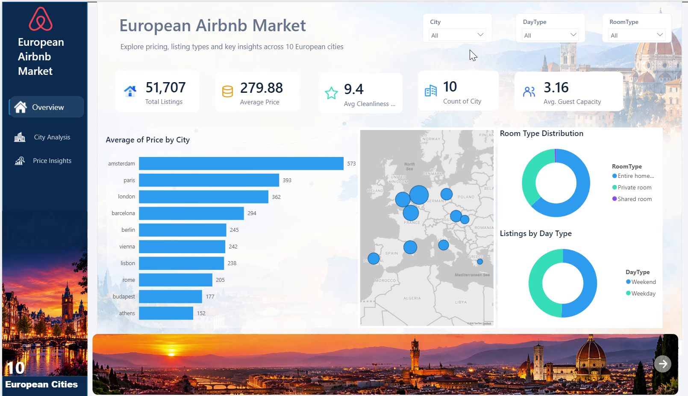
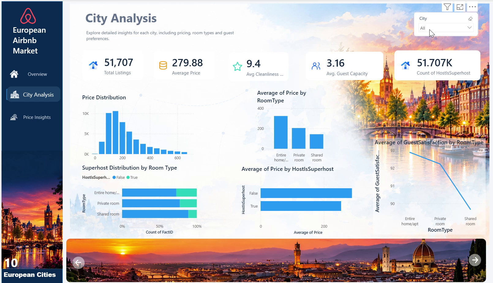
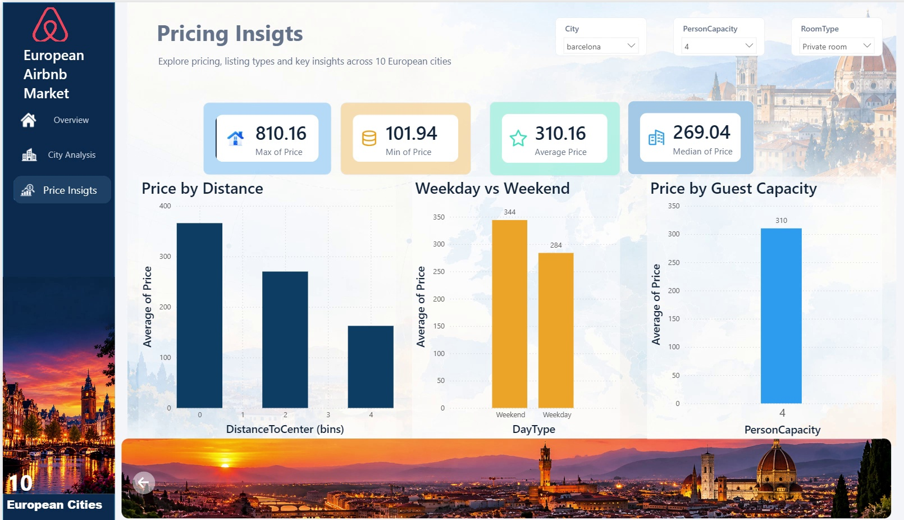

# European Airbnb Analytics

I built this project to compare Airbnb prices and room types across 10 European cities. I used SQL Server to prepare the data and Power BI to explore it.

## Data

The local dataset has 51,707 rows across 20 CSV files, split into weekdays and weekends. It covers Amsterdam, Athens, Barcelona, Berlin, Budapest, Lisbon, London, Paris, Rome and Vienna.

Each row is a source observation. Weekday and weekend records should not be treated as unique properties without a shared property ID.

## What I did

- Imported the CSV files into separate Bronze tables.
- Combined them in Silver, converted data types and kept the source file and city.
- Built a Gold fact table with city, room type and day type dimensions.
- Added checks for missing values, invalid values, duplicates and relationships.
- Flagged price outliers using IQR within each city and room type.
- Created a reporting view and a three-page Power BI report.

The flow is: CSV files → Bronze → Silver → Gold → Power BI.

## Dashboard

### Overview


### City Analysis


### Price Insights


These are frames from my demo recording. The filters shown in each image affect the numbers.

## Files

```text
sql/                 Setup, loading, validation and reporting queries
docs/screenshots/    Report screenshots
docs/                Model, data inventory and setup notes
data/                Instructions for adding the source CSV files
powerbi/             Instructions for opening the local report
```

## Run the project

1. Use SQL Server 2017 or later and SQL Server Management Studio.
2. Put the 20 CSV files in `C:\AirbnbData\`, or change the two paths in `sql/01-bronze-import.sql`. SQL Server needs read access to that folder on the server machine.
3. Run `00-setup.sql`, then the remaining SQL files in numerical order against a new project database.
4. Check the validation results before moving to the next layer. The Bronze loader prints import errors and continues, so check all 20 tables were loaded.
5. Open the local `Air.pbix` in Power BI Desktop. Check its data source settings and update local connections before refreshing. `GOLD.vw_AirbnbMaster` is the reporting view supplied here.

The SQL scripts were reviewed as files; they have not been executed against SQL Server as part of preparing this repository. See [setup notes](docs/setup-notes.md) before rerunning them.

## Data availability

Raw CSV files and the PBIX are kept outside this public repository for now. The original dataset link and redistribution terms still need to be added. The PBIX also contains an embedded data model, so it needs the same review as the source data before sharing.

Prices use the source `realSum` field. Currency, collection dates and the pricing period still need to be confirmed from the original dataset documentation.